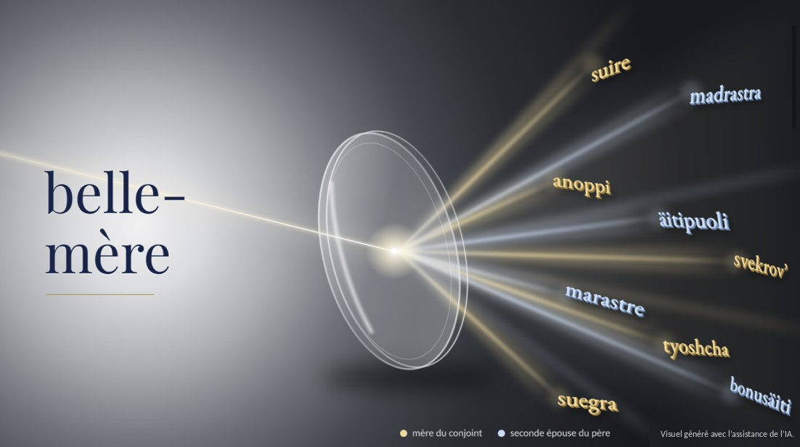

Nous avons parfois tendance à considérer une langue comme un simple outil de communication ; une sorte de boîte à lego dans laquelle nous piochons les briques dont nous avons besoin pour exprimer ce que nous pensons déjà.

Mais l’expérience d’une langue étrangère peut suggérer autre chose.

L’erreur communément commise lorsqu’on ne maîtrise pas encore bien une langue, c’est de penser une phrase dans sa langue maternelle puis de la traduire, plus ou moins littéralement selon son niveau de maîtrise, dans la langue cible.

Le résultat peut être chanceux : on arrive à se faire comprendre. Bien souvent aussi, on a écorché la grammaire et perdu les nuances au passage. Dans le pire des cas, la traduction a perdu le sens de la phrase d’origine.

Résumer la langue à un outil, c’est refuser d’accepter que la langue d’un autre nous oblige à remarquer quelque chose que la nôtre nous permettait d’ignorer, ou inversement.

## Un mot qui semblait parfaitement banal

Tout a commencé avec un mot du quotidien : belle-mère.

Pour un francophone, le mot paraît évident. Pourtant, le français a longtemps dit autrement. En ancien français, on distinguait « *marastre* », la seconde épouse du père, et « *suire* », la mère du conjoint (1). « *Marastre* », du latin « *matrastra* », a donné notre « *marâtre* ». Son suffixe, déjà dépréciatif en latin, a fini par déteindre sur le mot : « *marâtre* » n’est plus aujourd’hui qu’un synonyme péjoratif de belle-mère (1).

La langue l’a alors remplacé par « *belle-mère* ». « *Belle* » y est un terme de courtoisie, au sens de « *chère* » (2). Appliqué d’abord à la seconde épouse du père au XVe siècle, le mot s’est étendu à la mère du conjoint au XVIe (1), comme pour le reste de la parenté par alliance : beau-père, beau-frère, belle-sœur.

Ainsi, en adoucissant le mot, le français a fusionné deux liens que beaucoup de langues voisines gardent séparés.

Le mot adouci n’a cependant pas effacé le soupçon. En 1697, chez Perrault, la seconde épouse du père de Cendrillon est déjà une « *belle-mère* », et c’est elle qui « *fit éclater sa mauvaise humeur* » (3).

> Le mot avait changé, le personnage est resté.

Au XXe siècle, la langue familière a même rendu au mot ce que « *belle* » lui avait retiré : la « *belle-doche* » (4), rappelant ainsi les tensions que la belle-mère a parfois le don de susciter. Chacun sera libre de partager ou non cette dernière phrase.

L’espagnol a conservé la distinction, et le suffixe avec elle. « *Madrastra* » garde le *-astra* dont le français s’est détourné en délaissant « *marâtre* », et ce suffixe forme encore aujourd’hui des mots péjoratifs (5), comme « *politicastro(a)* », politicien(ne) de pacotille, ou « *musicastro(a)* », pseudo-musicien(ne).

« *Suegra* », la mère du conjoint, raconte une autre histoire.

Le mot vient du latin « *socrus* » et, en remontant plus loin, d’une racine indo-européenne qui désignait seulement la mère du mari. Il n’existait pas de mot équivalent pour la famille de l’épouse (6). La langue regardait du point de vue de la mariée, celle qui quittait sa maison.

Aujourd’hui, « *suegra* » vaut pour les deux côtés. Le russe « *svekrov’* », issu de la même racine, a au contraire gardé son sens d’origine, la mère du mari, à côté de « *tyoshcha* », la mère de l’épouse.

Quant au polonais, il a perdu le mot qui désignait la mère du mari.

> Là où les couples ont cessé de s’installer chez le mari, la langue a souvent cessé de marquer de quel côté venait la belle-mère.

La seconde épouse du père, elle, garde presque partout son propre mot. Le finnois, qui dit « *anoppi* » pour la mère, peu importe le conjoint, appelle la seconde épouse « *äitipuoli* ». Mais le suffixe « *-puoli* », qui signifie « moitié » ou « côté », crée une distance que des locuteurs interrogés jugent difficile, et « *bonusäiti* », la « mère bonus », est désormais régulièrement employé (7).

Roman Jakobson l’avait déjà formulé : les langues diffèrent moins par ce qu’elles permettent de dire que par ce qu’elles obligent à dire (8).

## Des mots différents… ou des questions différentes ?

Pour parler correctement, une langue nous oblige souvent à répondre à certaines questions avant même que nous en ayons conscience. La mère de qui ? De quel côté de la famille ? Par mariage ou par remariage ?

Certaines langues tiennent ces distinctions pour essentielles, d’autres les laissent dans l’implicite. Et le phénomène dépasse largement la famille.

## Qui agit ? Qui subit ?

Un vase tombe et se brise.

Selon les langues, l’attention ne se porte pas naturellement au même endroit.

Le français offre trois perspectives :

- « <em><b>J’ai</b> cassé le vase.</em> » → focalisation sur l’agent ;
- « <em>Le vase <b>s’est</b> cassé.</em> » → focalisation sur l’événement, le changement d’état ;
- « <em>Le vase <b>a été</b> cassé.</em> » → focalisation sur le résultat subi (passif).

Dans l’usage courant, je constate pourtant que le français emploie très volontiers la tournure pronominale « *Le vase s’est cassé* », même lorsque quelqu’un l’a fait tomber.

À l’instar du français, certaines langues d’Asie de l’Est, comme le japonais, recourent fréquemment à des constructions où l’état résultant, ou le changement d’état, compte davantage que l’agent. Il s’agit d’une préférence grammaticale ou discursive.

La question implicite est alors : que s’est-il passé ?

L’espagnol offre lui aussi trois options :

- « <em>Rompí el jarrón.</em> » (J’ai cassé le vase.)
- « <em><b>Se</b> rompió el jarrón.</em> » (Le vase s’est cassé.)
- « <em><b>Se me</b> rompió el jarrón.</em> » (mot à mot : « le vase se m’est cassé », où « me » désigne la personne à qui l’accident arrive ; la formulation présente le fait comme un événement subi plutôt que comme une action commise.)

À l’inverse, en anglais, lorsqu’un accident est causé par quelqu’un, on dira souvent « *I broke the vase* » (J’ai cassé le vase). L’auteur de l’action est placé au premier plan, et la question implicite devient : qui a agi ?

Cette différence de récit laisse même une trace dans la mémoire. Dans une étude publiée en 2010, Caitlin Fausey, Lera Boroditsky et leurs collègues ont montré des vidéos d’accidents à des anglophones et à des japonophones. Les anglophones décrivaient plus souvent ces accidents en nommant leur auteur, et ils se souvenaient mieux de qui les avait causés (9).

## Est-ce vrai ? Comment le sais-tu ?

Le rapport à la preuve fournit une autre illustration.

Le français permet d’exprimer les nuances, mais ne l’exige pas :

- <em>Il pleut.</em> (Le locuteur ne précise pas comment il le sait.)
- <em><b>Il paraît qu’</b>il pleut.</em> (Le locuteur indique une source indirecte.)
- <em><b>J’imagine qu’</b>il pleut.</em> (Le locuteur indique une déduction.)

De même, je peux dire « *Pierre est parti* » sans rien préciser. Je peux l’avoir vu partir, on peut me l’avoir raconté, je peux simplement le supposer : la phrase reste correcte.

Dans certaines langues, comme le turc, la grammaire demande bien plus souvent de préciser la source de l’information : on parle de langue à évidentialité grammaticale (10). Au passé, le turc distingue ainsi :

- <em>Pierre git<b>ti</b></em> : Pierre est parti, et je le sais pour l’avoir constaté ;
- <em>Pierre git<b>miş</b></em> : Pierre est parti, à ce qu’on m’a dit ou à ce que j’en déduis.

La langue conduit ainsi le locuteur à signaler la provenance de ce qu’il affirme.

## Le temps ou le déroulement ?

Nous pensons souvent que les langues diffèrent surtout dans leur manière de parler du temps. Or certaines attirent davantage l’attention sur l’état de l’action : est-elle terminée ? En cours ? Répétée ? Son résultat est-il encore visible ?

En français, on dira souvent : « *J’ai mangé*. » Le français marque à la fois le temps et, en partie, l’aspect : « *je mangeais* » ou « *j’étais en train de manger* » ne disent pas la même chose que « *j’ai mangé* ».

Le mandarin, lui, ne marque pas le temps dans le verbe : il s’appuie sur l’aspect.

- 我吃了 (<em>wǒ chī <b>le</b></em>) : « j’ai fini de manger », l’équivalent de notre « j’ai mangé » ; le marqueur de l’accompli se place après le verbe ;
- 我在吃 (<em>wǒ <b>zài</b> chī</em>) : « je suis en train de manger » ; le marqueur de ce qui est en cours se place avant le verbe ;
- 我吃过 (<em>wǒ chī <b>guo</b></em>) : « j’ai déjà mangé (au moins une fois) » ; l’accent porte sur l’expérience, et le marqueur se place après le verbe.

Le russe, de son côté, oblige souvent à choisir entre un verbe imperfectif et un verbe perfectif :

- читать (<em>chitat’</em>) : lire (imperfectif) ;
- прочитать (<em><b>pro</b>chitat’</em>) : lire jusqu’au bout, terminer la lecture (perfectif).

Le marqueur **про-** n’est pas un mot autonome : c’est un préfixe, qui fait partie intégrante du verbe.

Ici encore, la distinction centrale n’est pas tant *quand* l’action a eu lieu que *si elle a été menée à son terme*. C’est ce que les linguistes appellent l’aspect, par opposition au temps.

## Qui sommes-nous l’un pour l’autre ?

Dans certaines langues, il est presque impossible de parler sans tenir compte de la relation entre les interlocuteurs.

Le français impose un choix entre « *tu* » et « *vous* », qui renseigne en général sur le degré de familiarité, de distance ou de respect, avec des exceptions, notamment en milieu professionnel.

L’anglais n’en impose aucun : « *Have you eaten yet?* » ne dit rien de précis sur la relation entre celui qui pose la question et celui qui la reçoit.

En coréen, en japonais ou en vietnamien, le vocabulaire, les formes verbales ou les pronoms changent selon l’interlocuteur.

En vietnamien, demander simplement « As-tu mangé ? » suppose de situer d’abord l’autre : plus âgé ou plus jeune, proche ou distant, supérieur ou subordonné. Avant même de poser la question, il faut savoir quelle place on occupe par rapport à lui, dans la famille, dans la hiérarchie ou par l’âge.

La langue impose alors de nommer explicitement l’âge perçu de l’interlocuteur, alors que dans une société occidentale, on évite soigneusement de parler ou de demander l’âge d’une femme passé un certain âge.

> Une Occidentale, pour ne pas se vexer, devra donc recevoir le « **chị** » comme une marque de respect, plus qu’un avis sur son âge.

Dans un contexte professionnel, on s’adresse souvent à un collègue un peu plus âgé avec « *anh* » ou « *chị* », littéralement grand frère ou grande sœur, et à un collègue plus jeune avec « *em* ». Ce ne sont pas des titres hiérarchiques : ces mots situent les personnes l’une par rapport à l’autre, sur le modèle de la famille. Le supérieur hiérarchique a son propre terme : « *sếp* », le chef.

Ces termes remplacent souvent les pronoms « tu », « vous » et « je ».

- <em><b>Anh</b> / <b>Chị</b> ăn chưa ?</em> → « As-tu mangé ? » (à une personne légèrement plus âgée, avec une distinction homme/femme)
- <em><b>Em</b> ăn chưa ?</em> → « As-tu mangé ? » (à une personne plus jeune)
- <em><b>Bác</b> ăn chưa ?</em> → « Avez-vous mangé ? » (à une personne de la génération des parents)
- <em><b>Ông</b> / <b>Bà</b> ăn chưa ?</em> → « Avez-vous mangé ? » (à une personne âgée, avec une distinction homme/femme)

Au lieu de demander à son supérieur « Avez-vous lu le rapport ? », on dira plus naturellement « <em><b>Sếp</b> đã đọc báo cáo chưa ?</em> », soit « Chef, avez-vous déjà lu le rapport ? ». Le statut social est ainsi intégré directement dans la manière de désigner l’interlocuteur.

## Les langues orientent-elles notre pensée ?

Je ne crois pas qu’une langue nous dise quoi penser.

Mais elle nous habitue à remarquer certaines choses avant d’autres, au point d’influencer ce dont nous nous souvenons (9). Elle nous fournit une première grille de lecture : elle nous suggère quelles distinctions méritent d’être faites, quelles informations peuvent rester implicites et lesquelles doivent être précisées.

Les moyens de cette précision varient beaucoup d’une langue à l’autre : le choix des mots, un suffixe, un préfixe, une particule, une forme grammaticale.

## Ce que cela dit de l’IA

L’intelligence artificielle se heurte à ces mêmes questions.

Les modèles apprennent à partir d’immenses corpus de textes produits dans des langues qui ne rendent pas visibles les mêmes aspects de la réalité.

Or, de mon point de vue, l’une des difficultés majeures de l’IA est justement la gestion de l’implicite, qui met à rude épreuve son moteur probabiliste.

Pour traduire « Pierre est parti » en turc, un modèle doit choisir entre <em>git<b>ti</b></em> et <em>git<b>miş</b></em>, entre l’information constatée et l’information rapportée. Le français lui permet de rester flou ; le turc l’oblige à préciser. Si le contexte ne le dit pas, le modèle doit l’inférer.

La même difficulté apparaît lorsqu’il faut deviner :

- le degré de politesse attendu ;
- la responsabilité d’un acteur ;
- ou le sens exact d’une relation sociale.

L’implicite lui-même varie d’une langue à l’autre. Le japonais ou le chinois omettent volontiers le sujet ou le complément quand le contexte les rend évidents ; le français et l’anglais les exigent le plus souvent.

Lorsqu’une langue exige une information que l’autre laisse implicite, traduire, c’est interpréter.

Le modèle doit alors parfois ajouter ce que le texte d’origine ne disait pas. Il ne l’invente pas au sens strict : il retient ce que le contexte qu’on lui donne rend le plus probable.

> Trouver des mots lui est facile. La difficulté tient à tout ce qui n’est pas dit.

C’est peut-être l’une des raisons pour lesquelles l’intelligence artificielle donne parfois l’impression de comprendre sans vraiment comprendre. Elle maîtrise remarquablement les réponses, mais les langues humaines sont aussi des systèmes de questions implicites, et ces questions ne sont pas les mêmes partout.

Pour un modèle, passer du français au turc, du vietnamien au japonais ou de l’espagnol à l’anglais, c’est passer sans filet d’une façon d’organiser l’expérience humaine à une autre.

> Ce qu’il calcule, c’est une probabilité de pertinence à géographie variable, quand ce qu’on attend de lui, c’est une justesse sans faille.

## Ma conclusion

Pendant longtemps, j’ai considéré le mot « belle-mère » comme une simple étiquette. Cette exploration autour d’un mot aussi banal m’a conduite à une recherche beaucoup plus large.

Chaque langue pose ses propres questions, et aucune de ces questions n’est universelle. Elles ne paraissent évidentes que lorsque notre langue nous a habitués à les considérer comme telles.

C’est peut-être pour cela que l’apprentissage d’une langue étrangère est une expérience si particulière. Il nous rappelle que nos catégories mentales ne sont pas toujours des propriétés du réel ; ce sont parfois de simples habitudes que notre langue nous a apprises.

À l’issue de cette recherche, je comprends aujourd’hui un peu mieux pourquoi l’on dit que « les voyages forment la jeunesse ».

> On croyait apprendre de nouveaux mots. On découvre surtout de nouvelles façons de mettre le monde en lumière.

## Références

(1) « Belle-mère », *Trésor de la langue française informatisé* (TLFi), ATILF, CNRS et Université de Lorraine, cnrtl.fr/definition/belle-mère

(2) A. Rey (dir.), *Dictionnaire historique de la langue française*, Paris, Le Robert, édition ultime, impression juin 2024, entrée « beau, belle »

(3) C. Perrault, *Cendrillon ou la petite pantoufle de verre*, 1697

(4) « Belle-doche », *La langue française* (dictionnaire en ligne), lalanguefrancaise.com

(5) Real Academia Española, *Diccionario de la lengua española*, entrée « -astro, -astra », dle.rae.es/-astro

(6) T. Pronk, « Mobility, kinship, and marriage in Indo-European society », in K. Kristiansen, G. Kroonen et E. Willerslev (dir.), *The Indo-European Puzzle Revisited*, Cambridge, Cambridge University Press, 2023, p. 289-295 (passage cité p. 290). doi:10.1017/9781009261753.026

(7) K. Huupponen, *Bonusäiti, isän uus ja ne kumppanin lapset edellisestä liitosta*, mémoire de licence, Université de Jyväskylä, 2017

(8) R. Jakobson, *Essais de linguistique générale*, Paris, Éditions de Minuit, 1963, chapitre « Aspects linguistiques de la traduction »

(9) C. M. Fausey, B. L. Long, A. Inamori et L. Boroditsky, « Constructing agency: the role of language », *Frontiers in Psychology*, 2010

(10) A. A. Aksu-Koç et D. I. Slobin, « A psychological account of the development and use of evidentials in Turkish », in W. Chafe et J. Nichols (dir.), *Evidentiality: The Linguistic Coding of Epistemology*, Norwood (New Jersey), Ablex, 1986, p. 159-167
