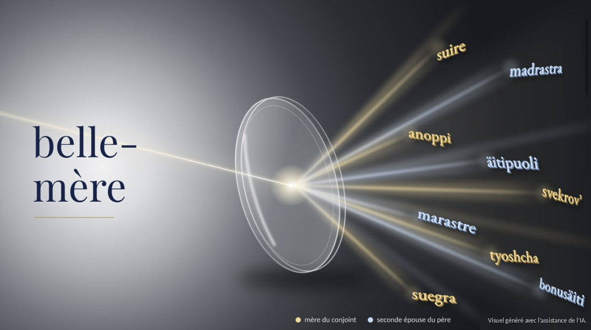

Quand ma belle-mère me fait comprendre le biais linguistique de l'IA.

On comprend intellectuellement ce que recouvre ce biais : les modèles sont entraînés sur des langues qui n'expriment pas toujours les choses de la même manière.

Mais réussir à s'approprier réellement cette idée est plus difficile. 
J'ai donc cherché un exemple simple, un mot du quotidien capable de révéler comment différentes langues expriment une même réalité de façon très différente.

Ce mot est : « belle-mère ».

En français, une belle-mère est à la fois la mère de son conjoint et la nouvelle épouse de son père. 
En anglais, ce n'est pas le cas. La mère de son conjoint est une « mother-in-law ». La nouvelle épouse du père est une « stepmother ».

Là où le français fusionne, l'anglais distingue.

En russe, en coréen ou en chinois, le mot change selon qu'il s'agit de la mère du mari ou de la mère de l'épouse. 
En tamoul, la belle-mère peut être désignée par le même terme qu'une tante, reflet d'une tradition où les alliances se nouaient souvent entre familles déjà liées.

Pourtant, les personnes désignées sont les mêmes.

Le français y ajoute une marque ambiguë d'affection ou de courtoisie : le « belle » de belle-mère.

L'anglais met en avant un lien né de la relation contractuelle de son enfant (« in-law »), ou la perte : « stepmother » vient d'une racine « steop » qui marquait la perte d'un parent.

D'autres langues mettent l'accent sur le côté de la famille dont est issue la belle-mère. Le tamoul rappelle une parenté préexistante.

Aucune de ces visions n'est plus juste qu'une autre. Elles révèlent simplement que les langues ne se contentent pas d'exprimer le monde différemment.

Elles choisissent ce qu'elles mettent en avant.

Et c'est là que le biais linguistique prend tout son sens. Pour traduire « ma belle-mère » en anglais, une IA doit choisir entre « mother-in-law » et « stepmother ». Si le texte français ne le précise pas, elle devine, à partir de ce que ses données d'apprentissage contenaient majoritairement. Et elle devinera le plus souvent dans le même sens.

La réalité, elle, n'a pas changé.

Ce que l'on en retient, c'est ce que la langue choisit de rendre visible et ce qu'elle laisse dans l'ombre.

