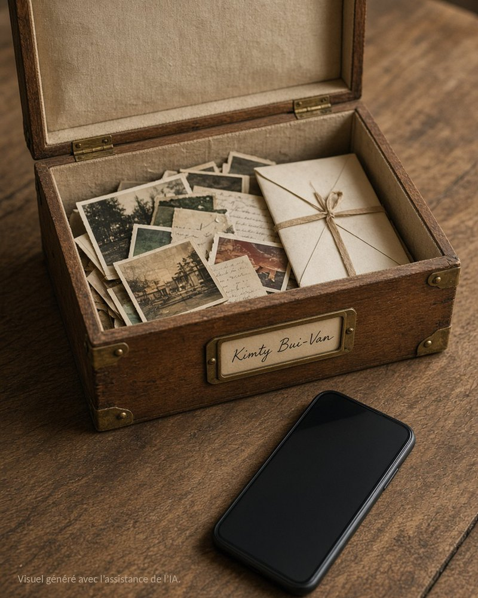

En ce temps de Toussaint, une question m'est venue à l'esprit : que restera-t-il de nous sur les plateformes ?

Pendant des siècles, la postérité se construisait à travers des découvertes, des livres, un poème, un tableau, une œuvre.

Pour la grande majorité d'entre nous, la mémoire se transmettait autrement : dans une boîte à souvenirs, de vieux albums photos, quelques lettres jaunies par le temps, des objets que l'on gardait sans toujours savoir pourquoi, mais qu'on ne pouvait se résoudre à jeter.

Aujourd'hui, une grande partie de cette mémoire existe aussi ailleurs, dans des serveurs.

Nous y déposons des milliers de photos, des années de messages et de commentaires, des publications, des historiques de recherche. Des fragments de nos vies, parfois intimes, que nous partageons sans même réaliser qu'ils pourront un jour contribuer à nous définir.

Je pense à cette femme qui continuait à payer l'abonnement téléphonique de son défunt mari pour le garder encore un peu près d'elle. Elle pouvait entendre son message d'absence et faire semblant de lui parler.

Que cette histoire soit vraie ou pas n'a pas d'importance. Elle nous bouleverse parce qu'elle révèle quelque chose d'universel.

On ne garde pas seulement un numéro de téléphone. On garde une présence, une illusion de continuité. Quelques secondes pendant lesquelles l'absence semble moins définitive.

Et pourtant, même ce souvenir-là a un prix. Il ne peut durer que tant que quelqu'un paie.

Jamais une génération n'a autant documenté son existence. Et documenter une vie, est-ce vraiment transmettre une mémoire ?

Lorsque nos enfants et nos petits-enfants consulteront nos archives numériques, découvriront-ils qui nous étions réellement ?

Une vie ne se résume pas à ce que l'on montre. Elle est aussi faite d'un parfum, d'une façon d'occuper l'espace, d'une pudeur, de ce que l'on tait, de ce que l'on oublie, de ce que l'on n'a jamais su raconter.

Dans cette époque obsédée par la visibilité, sommes-nous en train de construire notre héritage... ou simplement notre empreinte ?

Le 1er novembre nous rappelle que la mémoire humaine et la mémoire numérique ne sont pas nécessairement la même chose.

La seconde conserve des fragments, des images, des mots. Elle peut les figer avec une précision remarquable. Ces fragments, dépossédés de notre essence, ne racontent pas ce qui les reliait.

La première, elle, est imparfaite. Elle oublie, transforme, déforme et parfois embellit. Mais elle possède quelque chose qu'aucun serveur ne pourra reproduire : cette capacité de donner un sens à une existence.

Nous ne savons pas combien de temps nos données nous survivront. Mais nous savons que certaines personnes continuent de vivre en nous, bien longtemps après leur dernier message.

